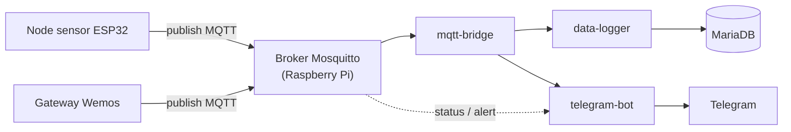

# Romyadhy Projects Documentation Living Lab

**Platform IoT Living Lab:** node sensor ESP32 / Wemos → MQTT (Mosquitto) → layanan Raspberry Pi → MariaDB + Telegram.

[English](README.md) | [Bahasa Indonesia](README.id.md)

> Terjemahan ini mengikuti versi Inggris (`README.md`). Jika ada perbedaan, versi Inggris yang dianggap benar.

---

## Arsitektur



Penjelasan lengkap: [docs/architecture.id.md](docs/architecture.id.md)

---

## Komponen

| Komponen | Folder | Bahasa | Dokumentasi |
|---|---|---|---|
| Node sensor ESP32 | `firmware/esp32-sensor-node` | C++ (PlatformIO) | [README](firmware/esp32-sensor-node/README.md) |
| Gateway Wemos | `firmware/wemos-gateway` | C++ (PlatformIO) | [README](firmware/wemos-gateway/README.md) |
| MQTT bridge | `services/mqtt-bridge` | Python 3.11 | [README](services/mqtt-bridge/README.md) |
| Data logger | `services/data-logger` | Python 3.11 | [README](services/data-logger/README.md) |
| Telegram bot | `services/telegram-bot` | Python 3.11 | [README](services/telegram-bot/README.md) |

> Nama folder menunjukkan **peran**, bukan tipe board. Pemetaan board → peran: [docs/hardware.md](docs/hardware.md)

---

## Mulai cepat

```bash
git clone <repo-url> && cd Romyadhy
cp .env.example .env          # lalu isi kredensial MQTT dan DB
sudo apt install mosquitto mosquitto-clients mariadb-server
mysql -u root -p < db/schema.sql
scripts/run_services.sh       # menjalankan bridge, logger, bot
```

Cek data mengalir:

```bash
mosquitto_sub -t 'livinglab/#' -v
```

Panduan lengkap Raspberry Pi (systemd, autostart, backup): [docs/deployment.id.md](docs/deployment.id.md)

---

## Perangkat keras (ringkasan)

| Board | Peran | Komponen utama | Dokumentasi |
|---|---|---|---|
| ESP32 | Node sensor | TODO: daftar sensor | [docs/hardware.md](docs/hardware.md) |
| Wemos D1 mini | TODO: peran | TODO: komponen | [docs/hardware.md](docs/hardware.md) |
| Raspberry Pi | Broker + layanan + DB | — | [docs/deployment.id.md](docs/deployment.id.md) |

---

## Dokumentasi

| Dokumen | Isi |
|---|---|
| [architecture.id.md](docs/architecture.id.md) | Alur data end-to-end, tanggung jawab tiap layanan |
| [hardware.md](docs/hardware.md) | BOM, wiring, tabel pinout, pemetaan board → peran |
| [mqtt-topics.id.md](docs/mqtt-topics.id.md) | **Kontrak topik + payload** antara firmware dan Python |
| [database.md](docs/database.md) | Skema MariaDB, diagram ER, retensi, backup |
| [telegram-bot.md](docs/telegram-bot.md) | Perintah, setup token, chat id yang diizinkan |
| [deployment.id.md](docs/deployment.id.md) | Setup Pi: Mosquitto, MariaDB, venv, systemd |
| [troubleshooting.id.md](docs/troubleshooting.id.md) | Masalah umum dan cara mendiagnosis |
| [onboarding.id.md](docs/onboarding.id.md) | Checklist "clone → jalan" untuk kontributor baru |

---

## Status proyek

- [x] Struktur repositori dan dokumentasi
- [ ] Source firmware dimasukkan
- [ ] Source layanan Python dimasukkan
- [ ] Demo end-to-end terverifikasi

---

## Lisensi

TODO: pilih lisensi (MIT umum dipakai untuk proyek lab) dan tambahkan file `LICENSE`.