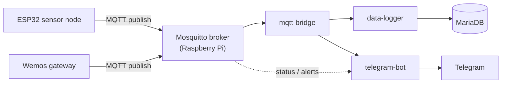

# Romyadhy Projects Documentation Living Lab

**Living Lab IoT platform:** ESP32 / Wemos sensor nodes → MQTT (Mosquitto) → Raspberry Pi services → MariaDB + Telegram.

[English](README.md) | [Bahasa Indonesia](README.id.md)

---

## Architecture



Full explanation: [docs/architecture.md](docs/architecture.md)

---

## Components

| Component | Folder | Language | Doc |
|---|---|---|---|
| ESP32 sensor node | `firmware/esp32-sensor-node` | C++ (PlatformIO) | [README](firmware/esp32-sensor-node/README.md) |
| Wemos gateway | `firmware/wemos-gateway` | C++ (PlatformIO) | [README](firmware/wemos-gateway/README.md) |
| MQTT bridge | `services/mqtt-bridge` | Python 3.11 | [README](services/mqtt-bridge/README.md) |
| Data logger | `services/data-logger` | Python 3.11 | [README](services/data-logger/README.md) |
| Telegram bot | `services/telegram-bot` | Python 3.11 | [README](services/telegram-bot/README.md) |

> Folder names describe the **role**, not the board model. Board → role mapping: [docs/hardware.md](docs/hardware.md)

---

## Quickstart

```bash
git clone <repo-url> && cd Romyadhy
cp .env.example .env          # then edit: MQTT and DB credentials
sudo apt install mosquitto mosquitto-clients mariadb-server
mysql -u root -p < db/schema.sql
scripts/run_services.sh       # starts bridge, logger, bot
```

Verify data is flowing:

```bash
mosquitto_sub -t 'livinglab/#' -v
```

Full Pi setup (systemd, autostart, backups): [docs/deployment.md](docs/deployment.md)

---

## Hardware (summary)

| Board | Role | Key components | Doc |
|---|---|---|---|
| ESP32 | Sensor node | TODO: sensor list | [docs/hardware.md](docs/hardware.md) |
| Wemos D1 mini | TODO: role | TODO: components | [docs/hardware.md](docs/hardware.md) |
| Raspberry Pi | Broker + services + DB | — | [docs/deployment.md](docs/deployment.md) |

---

## Documentation

| Document | What it covers |
|---|---|
| [architecture.md](docs/architecture.md) | End-to-end data flow, service responsibilities |
| [hardware.md](docs/hardware.md) | BOM, wiring, pinout tables, board → role mapping |
| [mqtt-topics.md](docs/mqtt-topics.md) | **Topic + payload contract** between firmware and Python |
| [database.md](docs/database.md) | MariaDB schema, ER diagram, retention, backup |
| [telegram-bot.md](docs/telegram-bot.md) | Commands, token setup, allowed chat ids |
| [deployment.md](docs/deployment.md) | Pi setup: Mosquitto, MariaDB, venv, systemd |
| [troubleshooting.md](docs/troubleshooting.md) | Common failures and how to diagnose |
| [onboarding.md](docs/onboarding.md) | "Clone → running" checklist for new contributors |

---

## Project status

- [x] Repository structure and documentation
- [ ] Firmware source added
- [ ] Python services source added
- [ ] End-to-end demo verified

---

## License

TODO: choose a license (MIT is a common choice for lab projects) and add `LICENSE`.