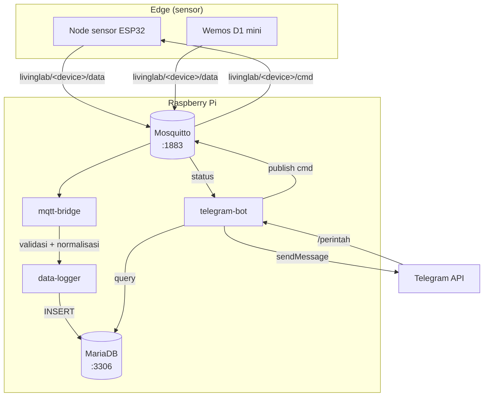
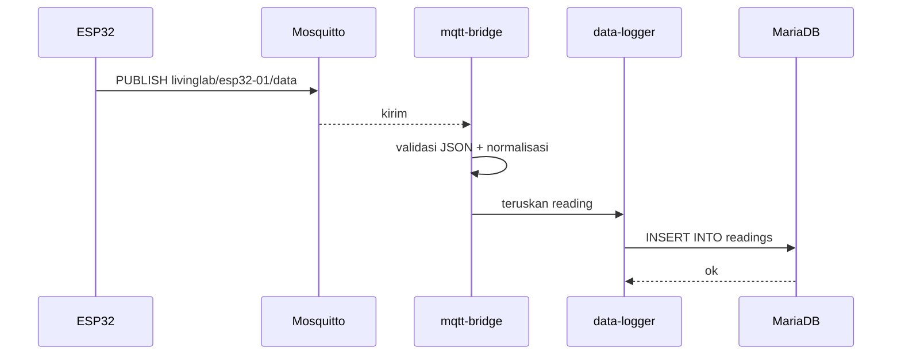

# Arsitektur

[English](architecture.md) | [Bahasa Indonesia](architecture.id.md)

## Gambaran umum

Living Lab adalah pipeline IoT dengan tiga lapisan:

1. **Edge** — board ESP32 dan Wemos membaca sensor lalu mem-publish pesan MQTT.
2. **Transport** — broker Mosquitto di Raspberry Pi menerima semua pesan.
3. **Backend** — layanan Python di Pi menormalisasi pesan, menyimpannya ke MariaDB, dan mengirim notifikasi lewat Telegram.

## Tanggung jawab

| Komponen | Menangani | **Tidak** menangani |
|---|---|---|
| Firmware (ESP32 / Wemos) | Membaca sensor, publish `data` dan `status`, menjalankan `cmd` | Akses DB langsung, panggilan Telegram |
| `mqtt-bridge` | Subscribe semua topik, validasi payload, normalisasi satuan, teruskan ke layanan berikutnya | Menulis ke database |
| `data-logger` | Menyimpan reading ke MariaDB, menjaga tipe data sesuai skema | Merespons perintah |
| `telegram-bot` | Perintah pengguna, alert, query DB, publish perintah ke device | Mengurai payload sensor mentah |

Dengan pemisahan ini, satu layanan bisa di-restart atau ditulis ulang tanpa mengganggu yang lain.

## Alur satu pesan

## Keputusan desain

| Keputusan | Alasan |
|---|---|
| MQTT, bukan HTTP | Bandwidth kecil, ada QoS, `retain` menyimpan status terakhir, cocok untuk ESP32 |
| Broker di Pi, bukan cloud | Jaringan lab lokal; logging tidak bergantung internet |
| Bridge dan logger dipisah | Logika validasi sering berubah; penulis DB sebaiknya stabil |
| MariaDB | Query relasional untuk laporan; sudah tersedia di lingkungan kampus |
| Konfigurasi `.env` | Satu kode untuk dev dan Pi; tidak ada rahasia di git |

## Keterbatasan yang diketahui

- TODO: catat titik kegagalan tunggal (misalnya satu broker, tanpa HA).
- TODO: catat apakah pesan diantre jika DB mati (QoS 1 + subscriber persisten).
- TODO: catat batasan jangkauan WiFi / penempatan node.