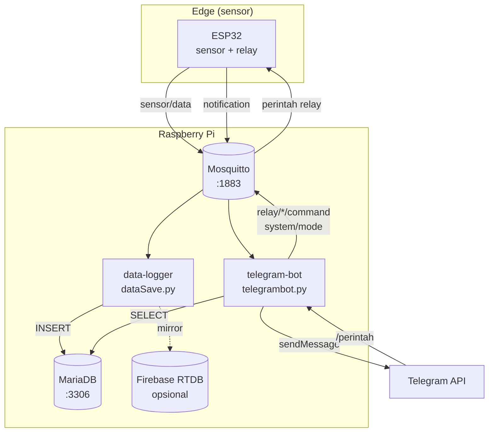
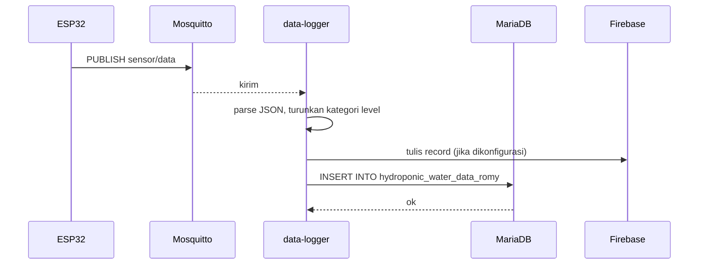
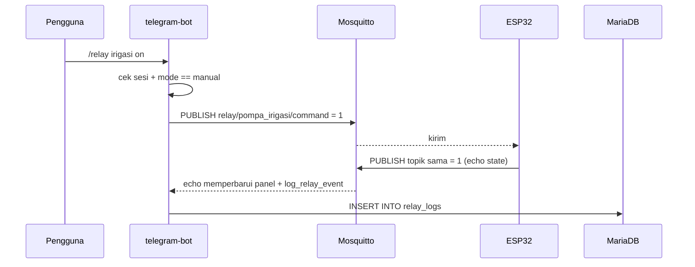

# Arsitektur

[English](architecture.md) | [Bahasa Indonesia](architecture.id.md)

## Gambaran umum

Living Lab adalah pipeline IoT dengan tiga lapisan:

1. **Edge** — ESP32 membaca sensor, mengendalikan relay, dan mem-publish pesan MQTT.
2. **Transport** — broker Mosquitto di Raspberry Pi menerima setiap pesan.
3. **Backend** — dua layanan Python di Pi: satu menyimpan reading, satu berbicara dengan pengguna.

## Tanggung jawab

| Komponen | Menangani | **Tidak** menangani |
|---|---|---|
| Firmware ESP32 | Membaca sensor, mengendalikan relay, publish `sensor/data` dan `notification`, menjalankan topik relay/mode/kalibrasi | Akses DB langsung, panggilan Telegram |
| `data-logger` | Subscribe `sensor/data`, meratakan JSON, menulis MariaDB, mirror Firebase opsional, peringatan watchdog | Validasi input perintah, berinteraksi dengan pengguna |
| `telegram-bot` | Antarmuka perintah, alert, kontrol relay, urutan kalibrasi, export CSV, log event relay | Menulis reading sensor ke DB |
| Mosquitto | Routing pesan, retained state untuk topik relay/mode | Logika bisnis |
| MariaDB | Riwayat permanen dan log event relay | Pengiriman real-time |

Sengaja **tidak ada MQTT bridge terpisah**: logger subscribe langsung ke broker. Validator perantara sempat dipertimbangkan lalu dibatalkan — payload kecil dan logger sudah mencatat input cacat beserta teks mentahnya.

## Alur pesan

### Satu reading sensor

Kedua layanan menerima pesan yang sama secara independen. Bot memperbarui dashboard di memori; logger menyimpan baris. Tidak ada yang menunggu yang lain.

### Satu perintah relay

Echo inilah yang menjaga panel tetap jujur: bot menampilkan state yang dilaporkan perangkat, bukan state yang dimintanya.

## Keputusan desain

| Keputusan | Alasan |
|---|---|
| MQTT, bukan HTTP | Bandwidth kecil, cocok untuk ESP32, retained message memberi state terakhir |
| Broker di Pi, bukan cloud | Jaringan lab lokal; logging tetap jalan tanpa internet |
| Logger subscribe langsung (tanpa bridge) | Satu komponen lebih sedikit; payload cacat dicatat beserta teks mentah |
| Penulisan di-throttle (`SAVE_THROTTLE_SECONDS`) | Sensor bisa publish jauh lebih cepat dari kebutuhan baris DB |
| Mirror Firebase opsional dan non-blocking | Gangguan cloud tidak boleh menghentikan logging lokal; `uploaded_to_cloud` menandai celahnya |
| Event relay di tabel terpisah | Query durasi/statistik murah dan tidak memindai tabel sensor yang besar |
| Konfigurasi `.env` | Satu kode untuk dev dan Pi; tidak ada rahasia di git |

## Keterbatasan yang diketahui

- **State di memori tidak persisten.** Sparkline bot, antrean alert, dan timer relay ON hilang saat restart. Hanya `relay_logs` yang permanen.
- **Satu broker, satu Pi.** Tanpa HA; restart broker memutus data langsung (topik retained tetap bertahan).
- **Tanpa buffering offline.** Jika DB mati, reading pada jendela itu hilang — tidak diantre.
- **Path Firebase bertabrakan dalam satu menit.** `<tanggal>/<HH-MM>` ditimpa bila dua record jatuh di menit yang sama.
- **Ambang level berbeda** antara logger (25/50/75) dan tampilan bot (30/75/100).
- **Data yang di-throttle tidak diisi ulang.** Throttle 60 detik dengan publish 5 detik membuang reading perantara secara desain.