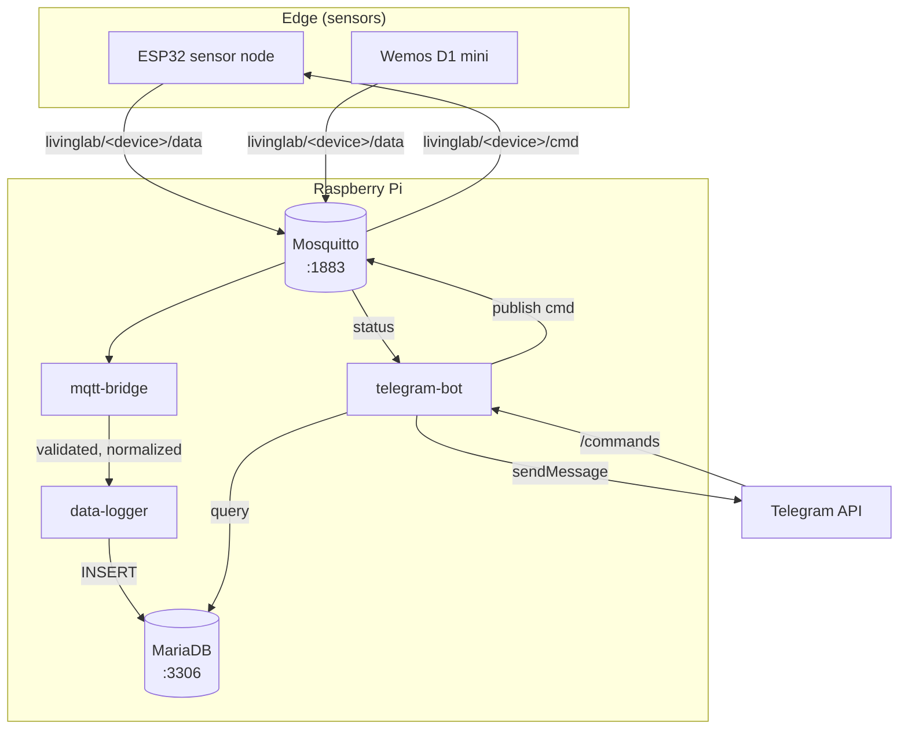
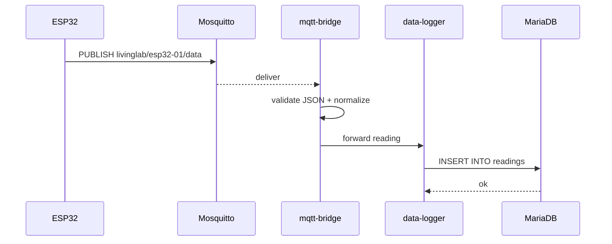

# Architecture

[English](architecture.md) | [Bahasa Indonesia](architecture.id.md)

## Overview

The Living Lab is an IoT pipeline with three layers:

1. **Edge** — ESP32 and Wemos boards read sensors and publish MQTT messages.
2. **Transport** — a Mosquitto broker on the Raspberry Pi receives every message.
3. **Backend** — Python services on the Pi normalize messages, persist them to MariaDB, and notify users over Telegram.

## Responsibilities

| Component | Owns | Does **not** do |
|---|---|---|
| Firmware (ESP32 / Wemos) | Reading sensors, publishing `data` and `status`, obeying `cmd` | Direct DB access, Telegram calls |
| `mqtt-bridge` | Subscribe to all topics, validate payload, normalize units, forward to downstream | Writing to the database |
| `data-logger` | Persist readings to MariaDB, enforce schema types | React to commands |
| `telegram-bot` | User commands, alerts, DB queries, publishing commands to devices | Parsing raw sensor payloads |

Keeping these separated means you can restart or rewrite one service without touching the others.

## Message flow (a single reading)

## Design decisions

| Decision | Reason |
|---|---|
| MQTT over HTTP | Low bandwidth, QoS, retain for last-known status, works well on ESP32 |
| Broker on the Pi, not in the cloud | Lab network is local; no internet dependency for logging |
| Separate bridge and logger | Validation logic changes often; the DB writer should stay stable |
| MariaDB | Relational queries for reports; already available on campus setups |
| `.env` configuration | One codebase for dev and Pi; no secrets in git |

## Known limitations

- TODO: document any single points of failure (e.g. one broker, no HA).
- TODO: note whether messages are queued if the DB is down (QoS 1 + subscriber persistence).
- TODO: note WiFi range / node placement constraints.