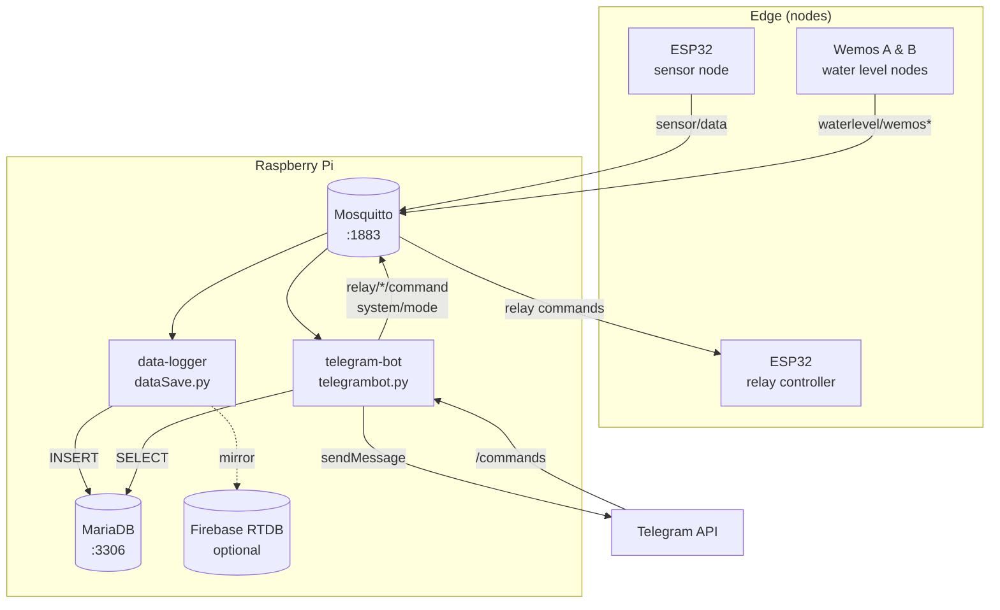
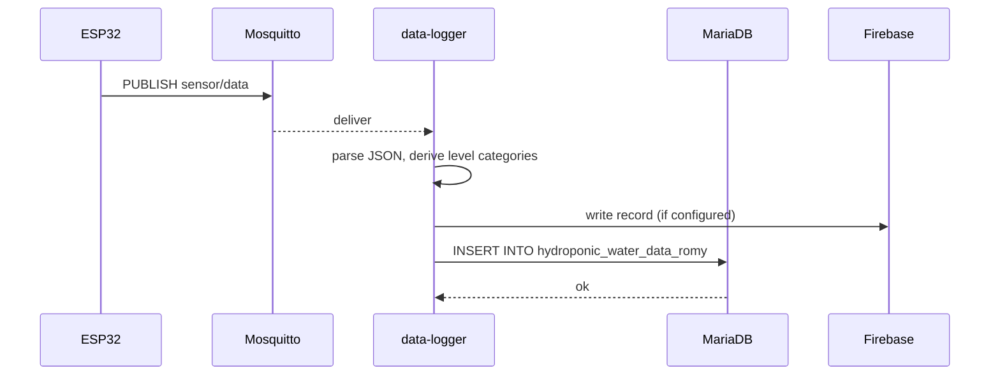
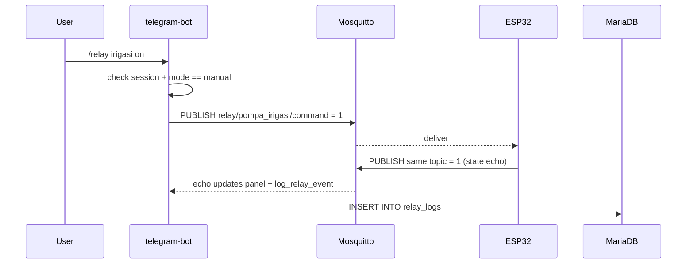

# Architecture

[English](architecture.md) | [Bahasa Indonesia](architecture.id.md)

## Overview

The Living Lab is an IoT pipeline with three layers:

1. **Edge** — the ESP32 reads sensors, drives relays, and publishes MQTT messages.
2. **Transport** — a Mosquitto broker on the Raspberry Pi receives every message.
3. **Backend** — two Python services on the Pi: one persists readings, one talks to users.

## Responsibilities

| Component | Owns | Does **not** do |
|---|---|---|
| ESP32 Sensor Node | Reading TDS, turbidity, flow, level 1–4, publishing `sensor/data`, calibration topics | Relay actuation, DB access |
| ESP32 Relay Controller | Subscribing to relay commands, timed drain sequences (`kuras_tandon`, `kuras`), driving 5 relays (active-LOW) | Sensor reading, DB access |
| Wemos Nodes (A & B) | High-precision water level reading via ADS1115, publishing `waterlevel/wemos*` | Relay control, DB access |
| `data-logger` | Subscribe to `sensor/data`, flatten JSON, write MariaDB, optional Firebase mirror, watchdog warnings | Validate command input, talk to users |
| `telegram-bot` | Command interface, alerts, relay control, calibration sequencing, CSV export, relay event log | Write sensor readings to the DB |
| Mosquitto | Message routing, retained state for relay/mode topics | Business logic |
| MariaDB | Durable history and relay event log | Real-time delivery |

There is deliberately **no separate MQTT bridge**: the logger subscribes to the broker directly. An intermediate validator was considered and dropped — the payload is small and the logger already logs malformed input with the raw text.

## Message flow

### A sensor reading

Both services receive the same message independently. The bot updates its in-memory dashboard; the logger persists the row. Neither waits for the other.

### A relay command

The echo is what keeps the panel honest: the bot shows the state the hardware reports, not the state it asked for.

## Design decisions

| Decision | Reason |
|---|---|
| MQTT over HTTP | Low bandwidth, works on ESP32, retained messages give last-known state |
| Broker on the Pi, not in the cloud | Lab network is local; logging keeps working without internet |
| Logger subscribes directly (no bridge) | One less moving part; malformed payloads are logged with raw text |
| Throttled writes (`SAVE_THROTTLE_SECONDS`) | Sensor may publish far faster than the DB needs rows |
| Firebase mirror is optional and non-blocking | Cloud outage must not stop local logging; `uploaded_to_cloud` marks the gap |
| Relay events in their own table | Duration/statistics queries are cheap and do not scan the big sensor table |
| `.env` configuration | One codebase for dev and Pi; no secrets in git |

## Known limitations

- **In-memory state is not persisted.** Bot sparklines, alert queue, and relay ON timers reset on restart. Only `relay_logs` is durable.
- **Single broker, single Pi.** No HA; a broker restart drops live data (retained topics survive).
- **No offline buffering.** If the DB is down, readings for that window are lost — they are not queued.
- **Firebase path collides within a minute.** `<date>/<HH-MM>` is overwritten if two records land in the same minute.
- **Level thresholds differ** between the logger (25/50/75) and the bot display (30/75/100).
- **Throttled data is not gap-filled.** A 60 s throttle with a 5 s publish rate discards the intermediate readings by design.