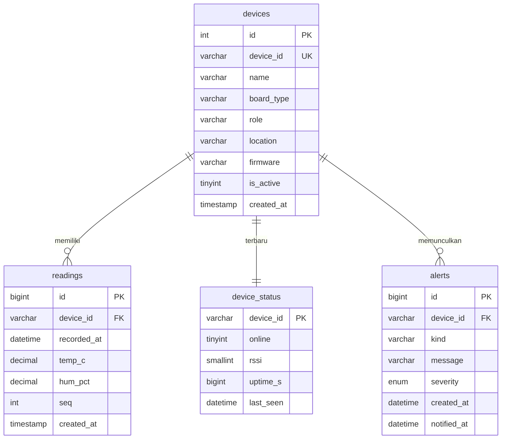

# Database (MariaDB)

[English](database.md) | [Bahasa Indonesia](database.id.md)

Acuan skema: [`db/schema.sql`](../db/schema.sql). Dokumen ini menjelaskan *alasannya*.

## Diagram ER



## Tabel

| Tabel | Fungsi | Laju pertumbuhan |
|---|---|---|
| `devices` | Registri board. Harus ada baris sebelum reading bisa masuk (FK). | Sangat lambat |
| `readings` | Riwayat sensor append-only. Tabel terbesar. | Cepat |
| `device_status` | Satu baris per device, di-update setiap pesan `status`. | Konstan |
| `alerts` | Pelanggaran ambang batas; `notified_at IS NULL` = belum dikirim ke Telegram. | Lambat |

## Keputusan desain

| Pilihan | Alasan |
|---|---|
| `DECIMAL(5,2)` untuk suhu/kelembapan, bukan `FLOAT` | Float biner menghasilkan `27.449999` di laporan. Decimal membandingkan dan menampilkan dengan tepat. |
| `DATETIME(3)` untuk `recorded_at` | Presisi milidetik; `TIMESTAMP` terbatas sampai 2038 dan dikonversi zona waktu. |
| `recorded_at` (waktu device) terpisah dari `created_at` (waktu server) | Clock drift dan buffering offline membuat keduanya berbeda. Query pakai `recorded_at`, diagnosis pakai `created_at`. |
| `device_id` sebagai natural key pada FK | Payload MQTT dan SQL identik; `devices.device_id` bersifat `UNIQUE`. |
| Index komposit `(device_id, recorded_at)` | Semua query nyata berbentuk "ambil device X pada rentang waktu". Tanpa index, performa jatuh sekitar 100 ribu baris. |
| `notified_at` nullable | Antrean murah: bot memilih `WHERE notified_at IS NULL` lalu update setelah terkirim. |
| `utf8mb4` | Pesan Telegram bisa berisi emoji. |

## Query umum

```sql
-- 24 jam terakhir untuk satu device
SELECT recorded_at, temp_c, hum_pct
FROM readings
WHERE device_id = 'esp32-01'
  AND recorded_at >= NOW() - INTERVAL 1 DAY
ORDER BY recorded_at DESC;

-- Rata-rata per jam
SELECT DATE_FORMAT(recorded_at, '%Y-%m-%d %H:00') AS jam,
       AVG(temp_c) AS avg_suhu,
       AVG(hum_pct) AS avg_kelembapan
FROM readings
WHERE device_id = 'esp32-01'
  AND recorded_at >= NOW() - INTERVAL 7 DAY
GROUP BY jam
ORDER BY jam;

-- Device yang berhenti mengirim
SELECT d.device_id, MAX(r.recorded_at) AS reading_terakhir
FROM devices d
LEFT JOIN readings r ON r.device_id = d.device_id
GROUP BY d.device_id
HAVING reading_terakhir IS NULL
    OR reading_terakhir < NOW() - INTERVAL 10 MINUTE;

-- Alert yang menunggu dikirim bot
SELECT id, device_id, kind, message
FROM alerts
WHERE notified_at IS NULL
ORDER BY created_at
LIMIT 20;
```

## Retensi

`readings` tumbuh tanpa batas. Batasi dengan penghapusan terjadwal:

```sql
DELETE FROM readings WHERE recorded_at < NOW() - INTERVAL 90 DAY;
```

atau agregasi dulu (tabel per jam), baru hapus. Jadwalkan dengan cron di Pi:

```cron
30 3 * * * mysql livinglab -e "DELETE FROM readings WHERE recorded_at < NOW() - INTERVAL 90 DAY;"
```

TODO: tentukan masa retensi untuk lab (90 hari adalah default yang wajar).

## Backup

```bash
scripts/backup_db.sh        # mysqldump --single-transaction | gzip, simpan 7 hari
```

Restore:

```bash
gunzip -c /var/backups/livinglab/livinglab-YYYY-MM-DD.sql.gz | mysql -u root -p livinglab
```

## Migrasi

Perubahan skema masuk ke `db/migrations/NNN_deskripsi.sql`, berurutan. Jangan mengedit migrasi yang sudah dijalankan; buat yang baru. `db/schema.sql` adalah kondisi penuh terkini untuk instalasi baru.

| File | Diterapkan |
|---|---|
| `001_init.sql` | TODO (tanggal) |