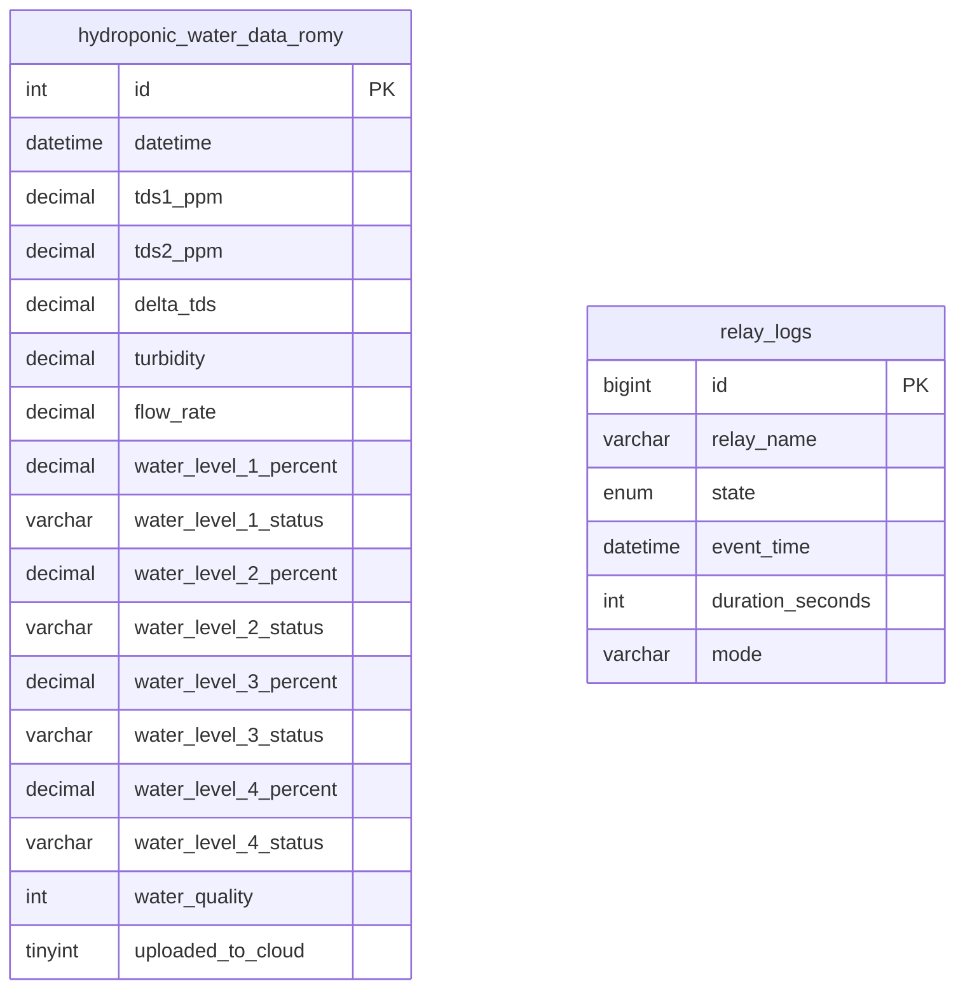

# Database (MariaDB)

[English](database.md) | [Bahasa Indonesia](database.id.md)

Acuan skema: [`db/schema.sql`](../db/schema.sql).

Dua tabel, masing-masing dimiliki tepat satu layanan:

| Tabel | Ditulis oleh | Dibaca oleh |
|---|---|---|
| `hydroponic_water_data_romy` | `data-logger` | `telegram-bot` (`/export`, `/status`) |
| `relay_logs` | `telegram-bot` | `telegram-bot` (`/relaylog`, `/relaystats`) |

Tidak ada yang lain menulis ke tabel ini, sehingga aturan kepemilikannya sederhana.

## Diagram ER



Tabel tidak dihubungkan foreign key: reading sensor dan event relay adalah dua aliran independen yang kebetulan berbagi database. Menggabungkannya berarti join pada jendela waktu, bukan pada id.

## `hydroponic_water_data_romy`

| Kolom | Tipe | Catatan |
|---|---|---|
| `id` | INT auto-increment | Surrogate key |
| `datetime` | DATETIME | **Waktu server saat insert**, bukan waktu device |
| `tds1_ppm`, `tds2_ppm` | DECIMAL(10,2) | Probe TDS |
| `delta_tds` | DECIMAL(5,2) | Selisih probe |
| `turbidity` | DECIMAL(10,2) | NTU |
| `flow_rate` | DECIMAL(10,2) | L/min |
| `water_level_N_percent` | DECIMAL(5,2) | Tandon 1–4 |
| `water_level_N_status` | VARCHAR(10) | Turunan: Empty / Low / Medium / High / Full |
| `water_quality` | INT | Kode 0–4, `-1` tidak diketahui |
| `uploaded_to_cloud` | TINYINT(1) | `1` bila penulisan Firebase berhasil |

### Kode kualitas air

| Kode | Arti |
|---|---|
| 0 | Keruh — nutrisi |
| 1 | Keruh — sedimen |
| 2 | Normal |
| 3 | Ketidakseimbangan nutrisi |
| 4 | Level rendah |
| -1 | Tidak diketahui / hilang dari payload |

Kolom menyimpan **kode**, bukan label. Pemetaan label ada di aplikasi (`dataSave.py` dan `telegrambot.py` sama-sama mendefinisikannya). Ini disengaja: kolom `INT` bisa diindeks, dirata-rata, dan dibandingkan; label `VARCHAR` tidak.

### Kategori level

| Persen | `water_level_N_status` |
|---|---|
| ≤ 0 | Empty |
| ≤ 25 | Low |
| ≤ 50 | Medium |
| ≤ 75 | High |
| > 75 | Full |

> Ambang tampilan bot berbeda (30 / 75 / 100). Status di DB adalah klasifikasi logger; bot mengklasifikasi ulang untuk tampilan dari persentase. Jangan diasumsikan sama.

## `relay_logs`

| Kolom | Tipe | Catatan |
|---|---|---|
| `id` | BIGINT auto-increment | |
| `relay_name` | VARCHAR(64) | `irigasi`, `kuras_tandon`, `kuras`, `pengaduk`, `valve_tandon`, `pompa_kuras` |
| `state` | ENUM('ON','OFF') | |
| `event_time` | DATETIME(3) | Presisi milidetik |
| `duration_seconds` | INT UNSIGNED | Hanya terisi pada baris OFF |
| `mode` | VARCHAR(16) | `auto` / `manual` saat event terjadi |

Durasi diukur di memori proses (`relay_last_on`) antara ON dan OFF. Jika bot restart saat relay ON, durasi itu hilang dan baris OFF mencatat `NULL`.

## Keputusan desain

| Pilihan | Alasan |
|---|---|
| `DECIMAL` untuk pengukuran | Float biner menghasilkan `27.449999` di laporan; DECIMAL membandingkan dan mencetak dengan tepat |
| `DATETIME` bukan `TIMESTAMP` | `TIMESTAMP` dibatasi 2038 dan dikonversi zona waktu. Ini pembacaan waktu dinding lokal |
| `water_quality` sebagai INT | Bisa diindeks dan diagregasi; label adalah urusan tampilan |
| Index pada `datetime` | Semua laporan adalah query rentang waktu |
| Index `(relay_name, event_time)` | `/relaylog` dan `/relaystats` memfilter per relay lalu urut waktu |
| Tanpa FK antar tabel | Dua aliran independen; relasi bermakna hanya lewat jendela waktu |
| Tidak ada duplikasi tabel log/DB | `dataSave.py` menjalankan `CREATE TABLE IF NOT EXISTS` saat start, jadi `schema.sql` dan kode konsisten |

## Query umum

```sql
-- Reading terbaru
SELECT datetime, tds1_ppm, tds2_ppm, turbidity, water_quality
FROM hydroponic_water_data_romy
ORDER BY id DESC LIMIT 10;

-- Rata-rata harian
SELECT DATE(datetime) AS hari,
       AVG(tds1_ppm) AS avg_tds,
       AVG(turbidity) AS avg_turb,
       AVG(flow_rate)  AS avg_flow
FROM hydroponic_water_data_romy
WHERE datetime >= NOW() - INTERVAL 7 DAY
GROUP BY hari ORDER BY hari;

-- Baris yang gagal diunggah ke cloud (penanda rekonsiliasi)
SELECT COUNT(*) FROM hydroponic_water_data_romy WHERE uploaded_to_cloud = 0;

-- Waktu ON per relay hari ini
SELECT relay_name, COALESCE(SUM(duration_seconds), 0) AS on_seconds
FROM relay_logs
WHERE state = 'OFF' AND DATE(event_time) = CURDATE()
GROUP BY relay_name;

-- Event relay terbaru
SELECT relay_name, state, event_time, duration_seconds, mode
FROM relay_logs ORDER BY event_time DESC LIMIT 20;

-- Celah pada data sensor (umpan temuan watchdog)
SELECT datetime,
       TIMESTAMPDIFF(MINUTE, LAG(datetime) OVER (ORDER BY datetime), datetime) AS gap_min
FROM hydroponic_water_data_romy
ORDER BY datetime DESC LIMIT 50;
```

## Retensi

Tabel sensor bertambah ~1440 baris/hari pada throttle 60 detik (~525 ribu baris/tahun) — masih wajar, tetapi tetap batasi:

```sql
DELETE FROM hydroponic_water_data_romy WHERE datetime < NOW() - INTERVAL 180 DAY;
DELETE FROM relay_logs WHERE event_time < NOW() - INTERVAL 180 DAY;
```

Jadwalkan di Pi:

```cron
30 3 * * * mysql livinglab -e "DELETE FROM hydroponic_water_data_romy WHERE datetime < NOW() - INTERVAL 180 DAY; DELETE FROM relay_logs WHERE event_time < NOW() - INTERVAL 180 DAY;"
```

Simpan `relay_logs` lebih lama bila Anda mengutip statistik waktu operasi di laporan — tabelnya kecil.

## Backup

```bash
scripts/backup_db.sh        # mysqldump --single-transaction | gzip, simpan 7 hari
```

Restore:

```bash
gunzip -c /var/backups/livinglab/livinglab-YYYY-MM-DD.sql.gz | mysql -u root -p livinglab
```

## Migrasi

Perubahan skema masuk ke `db/migrations/NNN_deskripsi.sql`, berurutan. Jangan mengedit migrasi yang sudah dijalankan; buat yang baru. `db/schema.sql` adalah kondisi penuh terkini untuk instalasi baru.

| File | Diterapkan |
|---|---|
| `001_init.sql` | TODO (tanggal) |