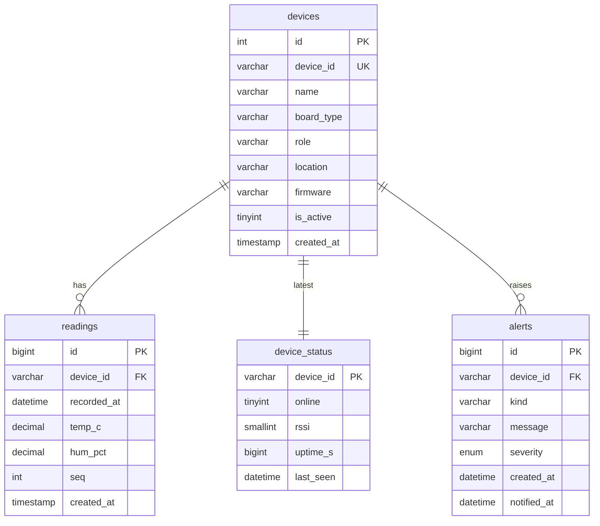

# Database (MariaDB)

[English](database.md) | [Bahasa Indonesia](database.id.md)

Source of truth for the schema: [`db/schema.sql`](../db/schema.sql). This document explains *why* it looks the way it does.

## ER diagram



## Tables

| Table | Purpose | Growth rate |
|---|---|---|
| `devices` | Registry of boards. Must contain a row before readings can be inserted (FK). | Tiny |
| `readings` | Append-only sensor history. The big table. | Fast |
| `device_status` | One row per device, updated on every `status` message. | Constant |
| `alerts` | Threshold breaches; `notified_at IS NULL` = still pending for Telegram. | Slow |

## Design decisions

| Choice | Reason |
|---|---|
| `DECIMAL(5,2)` for temperature/humidity, not `FLOAT` | Binary floats produce `27.449999` in reports. Decimals compare and display exactly. |
| `DATETIME(3)` for `recorded_at` | Millisecond precision; `TIMESTAMP` is limited to 2038 and is timezone-converted. |
| `recorded_at` (device time) separate from `created_at` (server time) | Clock drift and offline buffering mean they differ. Query on `recorded_at`, diagnose on `created_at`. |
| `device_id` as a natural key in FKs | Keeps MQTT payload and SQL identical; `devices.device_id` is `UNIQUE`. |
| `(device_id, recorded_at)` composite index | Every real query is "give me device X over time range". Without it performance collapses around 100k rows. |
| `notified_at` nullable timestamp | Cheap queue: bot selects `WHERE notified_at IS NULL` and updates after sending. |
| `utf8mb4` | Telegram messages may contain emoji. |

## Common queries

```sql
-- Last 24h for one device
SELECT recorded_at, temp_c, hum_pct
FROM readings
WHERE device_id = 'esp32-01'
  AND recorded_at >= NOW() - INTERVAL 1 DAY
ORDER BY recorded_at DESC;

-- Hourly averages
SELECT DATE_FORMAT(recorded_at, '%Y-%m-%d %H:00') AS hour,
       AVG(temp_c) AS avg_temp,
       AVG(hum_pct) AS avg_hum
FROM readings
WHERE device_id = 'esp32-01'
  AND recorded_at >= NOW() - INTERVAL 7 DAY
GROUP BY hour
ORDER BY hour;

-- Devices that stopped reporting
SELECT d.device_id, MAX(r.recorded_at) AS last_reading
FROM devices d
LEFT JOIN readings r ON r.device_id = d.device_id
GROUP BY d.device_id
HAVING last_reading IS NULL
    OR last_reading < NOW() - INTERVAL 10 MINUTE;

-- Pending alerts for the bot
SELECT id, device_id, kind, message
FROM alerts
WHERE notified_at IS NULL
ORDER BY created_at
LIMIT 20;
```

## Retention

`readings` grows without bound. Either keep it bounded with a scheduled delete:

```sql
DELETE FROM readings WHERE recorded_at < NOW() - INTERVAL 90 DAY;
```

or aggregate first (hourly table), then delete. Schedule via cron on the Pi:

```cron
30 3 * * * mysql livinglab -e "DELETE FROM readings WHERE recorded_at < NOW() - INTERVAL 90 DAY;"
```

TODO: decide the retention window for the lab (90 days is a reasonable default).

## Backup

```bash
scripts/backup_db.sh        # mysqldump --single-transaction | gzip, keeps 7 days
```

Restore:

```bash
gunzip -c /var/backups/livinglab/livinglab-YYYY-MM-DD.sql.gz | mysql -u root -p livinglab
```

## Migrations

Schema changes go in `db/migrations/NNN_description.sql`, in order. Never edit an applied migration; add a new one. `db/schema.sql` is the current full state for fresh installs.

| File | Applied |
|---|---|
| `001_init.sql` | TODO (date) |