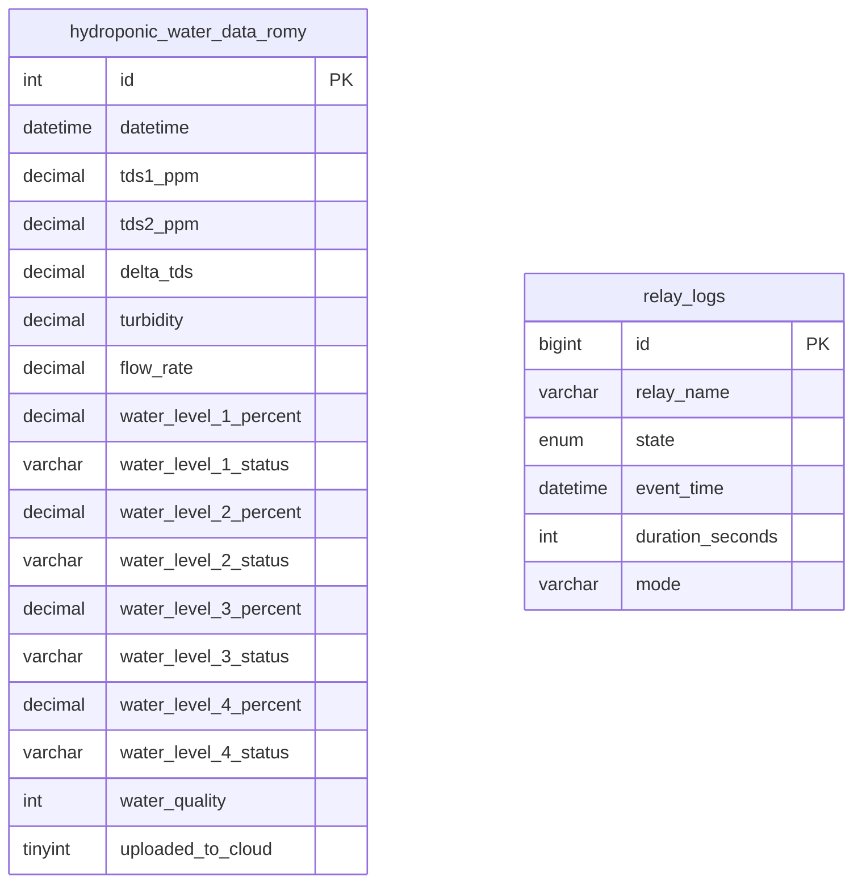

# Database (MariaDB)

[English](database.md) | [Bahasa Indonesia](database.id.md)

Source of truth for the schema: [`db/schema.sql`](../db/schema.sql).

Two tables, each owned by exactly one service:

| Table | Written by | Read by |
|---|---|---|
| `hydroponic_water_data_romy` | `data-logger` | `telegram-bot` (`/export`, `/status`) |
| `relay_logs` | `telegram-bot` | `telegram-bot` (`/relaylog`, `/relaystats`) |

Nothing else writes to these tables, which keeps the ownership rules simple.

## ER diagram



The tables are not related by a foreign key: sensor readings and relay events are independent streams that happen to share a database. Joining them means joining on a time window, not on an id.

## `hydroponic_water_data_romy`

| Column | Type | Notes |
|---|---|---|
| `id` | INT auto-increment | Surrogate key |
| `datetime` | DATETIME | **Server time at insert**, not device time |
| `tds1_ppm`, `tds2_ppm` | DECIMAL(10,2) | TDS probes |
| `delta_tds` | DECIMAL(5,2) | Probe difference |
| `turbidity` | DECIMAL(10,2) | NTU |
| `flow_rate` | DECIMAL(10,2) | L/min |
| `water_level_N_percent` | DECIMAL(5,2) | Tank 1–4 |
| `water_level_N_status` | VARCHAR(10) | Derived: Empty / Low / Medium / High / Full |
| `water_quality` | INT | Code 0–4, `-1` unknown |
| `uploaded_to_cloud` | TINYINT(1) | `1` if the Firebase write succeeded |

### Water quality codes

| Code | Meaning |
|---|---|
| 0 | Cloudy — nutrient |
| 1 | Cloudy — sediment |
| 2 | Normal |
| 3 | Nutrient imbalance |
| 4 | Level low |
| -1 | Unknown / missing in payload |

The column stores the **code**, not the label. The label mapping lives in the application (`dataSave.py` and `telegrambot.py` both define it). This is deliberate: an `INT` column can be indexed, averaged and compared; a `VARCHAR` label cannot.

### Level categories

| Percent | `water_level_N_status` |
|---|---|
| ≤ 0 | Empty |
| ≤ 25 | Low |
| ≤ 50 | Medium |
| ≤ 75 | High |
| > 75 | Full |

> The bot's display thresholds differ (30 / 75 / 100). The DB status is the logger's classification; the bot reclassifies for display from the percentage. Do not assume they agree.

## `relay_logs`

| Column | Type | Notes |
|---|---|---|
| `id` | BIGINT auto-increment | |
| `relay_name` | VARCHAR(64) | `irigasi`, `kuras_tandon`, `kuras`, `pengaduk`, `valve_tandon`, `pompa_kuras` |
| `state` | ENUM('ON','OFF') | |
| `event_time` | DATETIME(3) | Millisecond precision |
| `duration_seconds` | INT UNSIGNED | Set on the OFF row only |
| `mode` | VARCHAR(16) | `auto` / `manual` at the time of the event |

Duration is measured in process memory (`relay_last_on`) between ON and OFF. If the bot restarts while a relay is ON, that duration is lost and the OFF row records `NULL`.

## Design decisions

| Choice | Reason |
|---|---|
| `DECIMAL` for measurements | Binary floats produce `27.449999` in reports; DECIMAL compares and prints exactly |
| `DATETIME` not `TIMESTAMP` | `TIMESTAMP` is capped at 2038 and is timezone-converted. These are local wall-clock readings |
| `water_quality` as INT | Indexable and aggregatable; the label is a presentation concern |
| Index on `datetime` | Every report is a time-range query |
| `(relay_name, event_time)` index | `/relaylog` and `/relaystats` filter by relay then order by time |
| No FK between the tables | They are independent streams; a time-window join is the only meaningful relation |
| Duplicate log/DB tables avoided | `dataSave.py` runs `CREATE TABLE IF NOT EXISTS` on startup, so `schema.sql` and the code agree |

## Common queries

```sql
-- Latest readings
SELECT datetime, tds1_ppm, tds2_ppm, turbidity, water_quality
FROM hydroponic_water_data_romy
ORDER BY id DESC LIMIT 10;

-- Daily averages
SELECT DATE(datetime) AS day,
       AVG(tds1_ppm) AS avg_tds,
       AVG(turbidity) AS avg_turb,
       AVG(flow_rate)  AS avg_flow
FROM hydroponic_water_data_romy
WHERE datetime >= NOW() - INTERVAL 7 DAY
GROUP BY day ORDER BY day;

-- Rows the cloud upload missed (reconciliation marker)
SELECT COUNT(*) FROM hydroponic_water_data_romy WHERE uploaded_to_cloud = 0;

-- Relay ON-time per relay today
SELECT relay_name, COALESCE(SUM(duration_seconds), 0) AS on_seconds
FROM relay_logs
WHERE state = 'OFF' AND DATE(event_time) = CURDATE()
GROUP BY relay_name;

-- Recent relay events
SELECT relay_name, state, event_time, duration_seconds, mode
FROM relay_logs ORDER BY event_time DESC LIMIT 20;

-- Gaps in sensor data (feed the watchdog findings)
SELECT datetime,
       TIMESTAMPDIFF(MINUTE, LAG(datetime) OVER (ORDER BY datetime), datetime) AS gap_min
FROM hydroponic_water_data_romy
ORDER BY datetime DESC LIMIT 50;
```

## Retention

The sensor table grows by ~1440 rows/day at a 60 s throttle (~525k rows/year) — manageable, but cap it anyway:

```sql
DELETE FROM hydroponic_water_data_romy WHERE datetime < NOW() - INTERVAL 180 DAY;
DELETE FROM relay_logs WHERE event_time < NOW() - INTERVAL 180 DAY;
```

Schedule on the Pi:

```cron
30 3 * * * mysql livinglab -e "DELETE FROM hydroponic_water_data_romy WHERE datetime < NOW() - INTERVAL 180 DAY; DELETE FROM relay_logs WHERE event_time < NOW() - INTERVAL 180 DAY;"
```

Keep `relay_logs` longer if you cite runtime statistics in a report — it is small.

## Backup

```bash
scripts/backup_db.sh        # mysqldump --single-transaction | gzip, keeps 7 days
```

Restore:

```bash
gunzip -c /var/backups/livinglab/livinglab-YYYY-MM-DD.sql.gz | mysql -u root -p livinglab
```

## Migrations

Schema changes go in `db/migrations/NNN_description.sql`, in order. Never edit an applied migration; add a new one. `db/schema.sql` is the full current state for fresh installs.

| File | Applied |
|---|---|
| `001_init.sql` | TODO (date) |