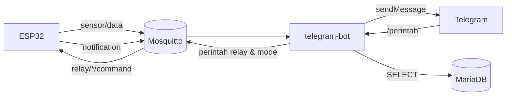

# Telegram Bot

[English](telegram-bot.md) | [Bahasa Indonesia](telegram-bot.id.md)

Implementasi dan daftar perintah lengkap: [`services/telegram-bot/README.id.md`](../services/telegram-bot/README.id.md)

Halaman ini membahas posisi bot dalam sistem dan aturan operasionalnya.

## Fungsi

Dua arah:

1. **Keluar** — dashboard terjadwal setiap 5 menit, ditambah alert dari ESP32 serta event mode/kalibrasi.
2. **Masuk** — perintah yang membaca MariaDB, publish MQTT ke ESP32, atau mengontrol relay.



## Tanggung jawab

| Menangani | **Tidak** menangani |
|---|---|
| Antarmuka perintah, alert, urutan kalibrasi, kontrol relay, export CSV | Menulis reading sensor ke DB (itu tugas `data-logger`) |

## Setup

1. Ambil token dari [@BotFather](https://t.me/BotFather) (`/newbot`).
2. Cari chat id: kirim pesan ke bot, lalu buka
   `https://api.telegram.org/bot<TOKEN>/getUpdates` dan baca `message.chat.id`.
3. Isi `.env`:

```env
TELEGRAM_BOT_TOKEN=123456:ABC-DEF...
TELEGRAM_CHAT_ID=123456789
TELEGRAM_ALLOWED_CHAT_IDS=123456789
ACCESS_PASSWORD=change_me
```

4. Restart layanan: `sudo systemctl restart telegram-bot`.

Jangan pernah menaruh token, password DB, atau `ACCESS_PASSWORD` di dalam file source. Semuanya dibaca dari environment saat start; nilai wajib yang hilang langsung menghentikan bot dengan pesan error yang jelas.

## Kontrol akses

| Lapis | Aturan |
|---|---|
| Allow-list chat | `TELEGRAM_ALLOWED_CHAT_IDS` — id di luar daftar diabaikan |
| Login sesi | `/login <password>` memulai sesi 1 jam, diperbarui tiap perintah |
| Kedaluwarsa sesi | Setelah `SESSION_TIMEOUT_SECONDS` tanpa aktivitas, perintah ditolak dan tombol inline berhenti berfungsi |
| Interlock mode auto | Perintah relay ditolak selama sistem dalam mode `auto` |

Pesan password dihapus begitu diterima, jadi tidak tertinggal di riwayat chat. Itu kenyamanan, bukan keamanan — ganti `ACCESS_PASSWORD` jika pernah dibagikan atau ter-commit.

## Alert

| Sumber | Topik | Penanganan |
|---|---|---|
| Pelanggaran ambang batas ESP32 | `<prefix>/notification` dengan `{"alert": "...", "level": "..."}` | Antre di memori, terkirim dalam 5 detik |
| Perubahan mode | `<prefix>/system/mode` | Pesan konfirmasi |
| Progres kalibrasi | `<prefix>/sensor/calibrate/turbidity/status` | Antre, terkirim dalam 1 detik |

`level` adalah salah satu dari `critical`, `warning`, `info`, `system` dan ditampilkan sebagai ikon pada pesan. Jika firmware tidak menyertakannya, bot menyimpulkan dari teks.

> Antrean alert berada di memori. Jika bot restart sebelum sempat menguras antrean, alert tersebut hilang. Hanya `relay_logs` yang permanen.

## Kesegaran data

Dashboard membawa badge agar reading usang tidak dikira data langsung:

| Badge | Usia pesan MQTT terakhir |
|---|---|
| 🟢 Fresh | di bawah 30 detik |
| 🟡 …s lalu | di bawah 5 menit |
| 🔴 …m lalu — cek ESP32 | 5 menit atau lebih |
| ⚪ belum ada data | belum ada yang diterima sejak start |

## Catatan keamanan

- Token dan password hanya lewat environment variable.
- Jaga allow-list tetap sempit: siapa pun di dalamnya bisa menyalakan dan mematikan pompa.
- Jangan log respons API Telegram penuh di level `INFO` — URL-nya mengandung token.
- Jika token bocor: `/revoke` di @BotFather, buat token baru, update `.env`, restart layanan, lalu `git log -p` untuk memastikan token tidak pernah ter-commit.

## Troubleshooting

| Gejala | Penyebab | Solusi |
|---|---|---|
| Bot diam | Layanan mati | `systemctl status telegram-bot`, `journalctl -u telegram-bot -n 50` |
| `401 Unauthorized` | Token salah atau dicabut | Cek ulang `.env`, restart |
| `Missing required environment variable` | `.env` tidak dimuat | Cek `EnvironmentFile=` pada unit |
| Perintah diabaikan | Chat id tidak diizinkan | Tambahkan ke `TELEGRAM_ALLOWED_CHAT_IDS`, restart |
| "Access Denied" | Belum login atau sesi kedaluwarsa | `/login <password>` |
| Bot keluar saat start | MQTT tidak terjangkau, dev mode mati | Nyalakan broker atau set `ALLOW_DEV_MODE=true` untuk demo |

Tabel lengkap: [`services/telegram-bot/README.id.md`](../services/telegram-bot/README.id.md#9-troubleshooting)