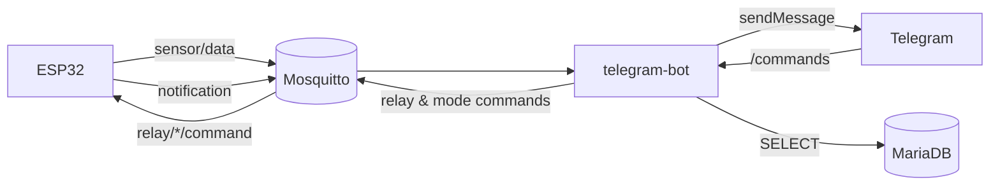

# Telegram Bot

[English](telegram-bot.md) | [Bahasa Indonesia](telegram-bot.id.md)

Implementation and full command reference: [`services/telegram-bot/README.md`](../services/telegram-bot/README.md)

This page covers how the bot fits into the system, and the operational rules.

## What it does

Two directions:

1. **Outbound** — scheduled dashboard every 5 minutes, plus alerts from the ESP32 and from mode/calibration events.
2. **Inbound** — commands that read MariaDB, publish MQTT to the ESP32, or control relays.



## Responsibilities

| Owns | Does not do |
|---|---|
| Command interface, alerts, calibration sequencing, relay control, CSV export | Write sensor readings to the DB (that is `data-logger`) |

## Setup

1. Get a token from [@BotFather](https://t.me/BotFather) (`/newbot`).
2. Find your chat id: message the bot, then open
   `https://api.telegram.org/bot<TOKEN>/getUpdates` and read `message.chat.id`.
3. Fill in `.env`:

```env
TELEGRAM_BOT_TOKEN=123456:ABC-DEF...
TELEGRAM_CHAT_ID=123456789
TELEGRAM_ALLOWED_CHAT_IDS=123456789
ACCESS_PASSWORD=change_me
```

4. Restart the service: `sudo systemctl restart telegram-bot`.

Never put the token, DB password, or `ACCESS_PASSWORD` in the source file. They are read from the environment at startup; a missing required value stops the bot immediately with a clear error.

## Access control

| Layer | Rule |
|---|---|
| Chat allow-list | `TELEGRAM_ALLOWED_CHAT_IDS` — ids not in the list are ignored |
| Session login | `/login <password>` starts a 1 h session, refreshed on every command |
| Session expiry | After `SESSION_TIMEOUT_SECONDS` of inactivity, commands are refused and inline buttons stop working |
| Auto mode interlock | Relay commands are refused while the system is in `auto` |

The password message is deleted as soon as it is received, so it does not linger in the chat history. That is convenience, not security — rotate `ACCESS_PASSWORD` if it has ever been shared or committed.

## Alerts

| Source | Topic | Handling |
|---|---|---|
| ESP32 threshold breach | `<prefix>/notification` with `{"alert": "...", "level": "..."}` | Queued in memory, sent within 5 s |
| Mode change | `<prefix>/system/mode` | Confirmation message |
| Calibration progress | `<prefix>/sensor/calibrate/turbidity/status` | Queued, sent within 1 s |

`level` is one of `critical`, `warning`, `info`, `system` and is shown as an icon in the message. If the firmware omits it, the bot infers it from the text.

> The alert queue lives in memory. If the bot restarts before draining it, those alerts are lost. Only `relay_logs` is durable.

## Data freshness

The dashboard carries a badge so a stale reading is never mistaken for a live one:

| Badge | Age of last MQTT message |
|---|---|
| 🟢 Fresh | under 30 s |
| 🟡 …s lalu | under 5 min |
| 🔴 …m lalu — cek ESP32 | 5 min or more |
| ⚪ belum ada data | nothing received since start |

## Security notes

- Token and passwords are environment variables only.
- Keep the allow-list narrow: anyone on it can start and stop pumps.
- Do not log full Telegram API responses at `INFO` — they contain the token in the URL.
- If the token leaks: `/revoke` in @BotFather, issue a new one, update `.env`, restart the service, then `git log -p` to confirm it was never committed.

## Troubleshooting

| Symptom | Cause | Fix |
|---|---|---|
| Bot silent | Service down | `systemctl status telegram-bot`, `journalctl -u telegram-bot -n 50` |
| `401 Unauthorized` | Token wrong or revoked | Recheck `.env`, restart |
| `Missing required environment variable` | `.env` not loaded | Check `EnvironmentFile=` in the unit |
| Commands ignored | Chat id not allowed | Add to `TELEGRAM_ALLOWED_CHAT_IDS`, restart |
| "Access Denied" | Not logged in or session expired | `/login <password>` |
| Bot exits at startup | MQTT unreachable, dev mode disabled | Start the broker or set `ALLOW_DEV_MODE=true` for a demo |

Full table: [`services/telegram-bot/README.md`](../services/telegram-bot/README.md#9-troubleshooting)