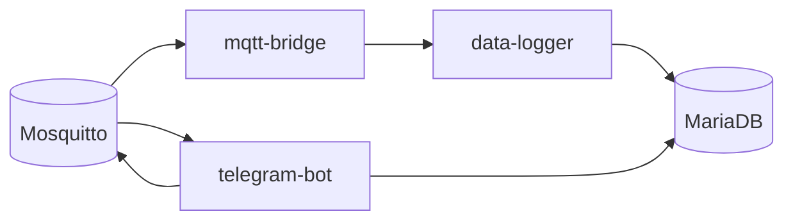

# Services

[English](README.md) | [Bahasa Indonesia](README.id.md)

Tiga layanan Python berjalan di Raspberry Pi, ditambah helper bersama.

| Layanan | Fungsi | Dijalankan sebagai |
|---|---|---|
| [`mqtt-bridge/`](mqtt-bridge/) | Subscribe semua topik, validasi dan normalisasi payload | `mqtt-bridge.service` |
| [`data-logger/`](data-logger/) | Menulis reading ke MariaDB | `data-logger.service` |
| [`telegram-bot/`](telegram-bot/) | Alert + perintah pengguna | `telegram-bot.service` |
| [`common/`](common/) | Config loader, koneksi DB, wrapper MQTT | *(library, bukan service)* |

## Hubungan antar layanan



## Konvensi

| Item | Aturan |
|---|---|
| Entry point | `main.py` di tiap folder layanan |
| Dependensi | `requirements.txt` per layanan |
| Konfigurasi | Dibaca dari environment; dev lokal memuat `.env` |
| Logging | Modul `logging` ke stdout (ditangkap journald di systemd) |
| Tanpa rahasia | Jangan hardcode token atau password |

## Jalankan lokal

```bash
scripts/run_services.sh
```

## Deploy

Lihat [../docs/deployment.id.md](../docs/deployment.id.md) dan template unit di [`../deploy/systemd/`](../deploy/systemd/).

## Menambah layanan

1. Buat `services/<nama>/` berisi `main.py`, `requirements.txt`, `README.md`.
2. Pakai ulang `services/common/` untuk config dan koneksi.
3. Tambahkan unit di `deploy/systemd/` dan dokumentasikan di README root.