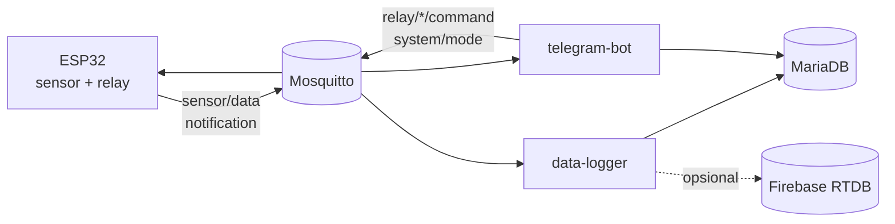

# Services

[English](README.md) | [Bahasa Indonesia](README.id.md)

Dua layanan Python berjalan di Raspberry Pi. Tidak ada MQTT bridge terpisah: data logger subscribe langsung ke broker.

| Layanan | Fungsi | Entry point | Dijalankan sebagai |
|---|---|---|---|
| [`data-logger/`](data-logger/) | Subscribe data sensor, menulis ke MariaDB + Firebase RTDB opsional | `dataSave.py` | `data-logger.service` |
| [`telegram-bot/`](telegram-bot/) | Alert, perintah, kontrol relay, kalibrasi, export CSV | `telegrambot.py` | `telegram-bot.service` |
| [`common/`](common/) | Config loader, koneksi DB, wrapper MQTT | — | *(library, bukan service)* |

## Status

| Layanan | Kode tersedia |
|---|---|
| `data-logger` | ✅ sudah ada (`dataSave.py`) |
| `telegram-bot` | ✅ sudah ada (`telegrambot.py`) |

## Hubungan antar layanan



Kedua layanan subscribe secara independen. Tidak ada yang bergantung pada yang lain: bot tetap menjawab perintah saat logger menulis baris.

## Konvensi

| Item | Aturan |
|---|---|
| Entry point | `dataSave.py` dan `telegrambot.py` |
| Dependensi | `requirements.txt` per layanan |
| Konfigurasi | Dibaca dari environment; dev lokal memuat `.env` dari root repo |
| Logging | Modul `logging`; journald menangkap stdout di systemd |
| Tanpa rahasia | Jangan hardcode token atau password — layanan berhenti jika nilai wajib hilang |
| State lokal | Log dan export CSV default ke `./logs` dan `./exports` di folder tiap layanan (diabaikan git) |

## Jalankan lokal

```bash
scripts/run_services.sh
```

Skrip menjalankan layanan yang ada dan melewati sisanya.

## Deploy

Lihat [../docs/deployment.id.md](../docs/deployment.id.md) dan template unit di [`../deploy/systemd/`](../deploy/systemd/).

## Menambah layanan

1. Buat `services/<nama>/` berisi entry point, `requirements.txt`, `README.md`.
2. Pakai ulang `services/common/` untuk config dan koneksi.
3. Tambahkan unit di `deploy/systemd/` dan daftarkan di sini serta di README root.
4. Tambahkan nama file entry point ke loop di `scripts/run_services.sh`.