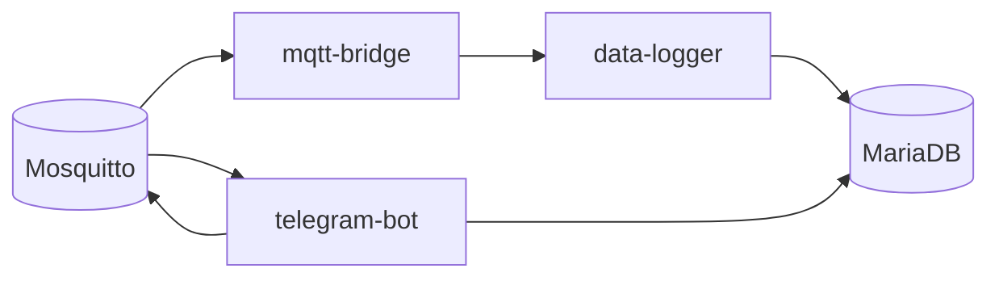

# Services

[English](README.md) | [Bahasa Indonesia](README.id.md)

Three Python services run on the Raspberry Pi, plus shared helpers.

| Service | Purpose | Entry point | Runs as |
|---|---|---|---|
| [`mqtt-bridge/`](mqtt-bridge/) | Subscribe to all topics, validate and normalize payloads | `main.py` | `mqtt-bridge.service` |
| [`data-logger/`](data-logger/) | Write readings to MariaDB | `main.py` | `data-logger.service` |
| [`telegram-bot/`](telegram-bot/) | Alerts, commands, relay control, calibration, CSV export | `telegrambot.py` | `telegram-bot.service` |
| [`common/`](common/) | Shared config loader, DB connection, MQTT wrapper | — | *(library, not a service)* |

## Status

| Service | Code present |
|---|---|
| `telegram-bot` | ✅ implemented (`telegrambot.py`) |
| `mqtt-bridge` | ⬜ planned — README describes the intended behaviour |
| `data-logger` | ⬜ planned — README describes the intended behaviour |

## How they connect



## Conventions

| Item | Rule |
|---|---|
| Entry point | `main.py` in each service folder (the bot uses `telegrambot.py`) |
| Dependencies | Per-service `requirements.txt` |
| Config | Read from environment; local dev loads `.env` |
| Logging | `logging` module to stdout (journald captures it under systemd) |
| No secrets | Never hardcode tokens or passwords — the bot fails fast if one is missing |

## Run locally

```bash
scripts/run_services.sh
```

## Deploy

See [../docs/deployment.md](../docs/deployment.md) and the unit templates in [`../deploy/systemd/`](../deploy/systemd/).

## Adding a service

1. Create `services/<name>/` with `main.py`, `requirements.txt`, `README.md`.
2. Reuse `services/common/` for config and connections.
3. Add a unit file in `deploy/systemd/` and document it in the root README.