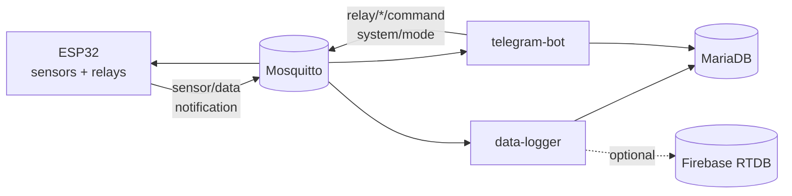

# Services

[English](README.md) | [Bahasa Indonesia](README.id.md)

Two Python services run on the Raspberry Pi. There is no separate MQTT bridge: the data logger subscribes to the broker directly.

| Service | Purpose | Entry point | Runs as |
|---|---|---|---|
| [`data-logger/`](data-logger/) | Subscribe to sensor data, write to MariaDB + optional Firebase RTDB | `dataSave.py` | `data-logger.service` |
| [`telegram-bot/`](telegram-bot/) | Alerts, commands, relay control, calibration, CSV export | `telegrambot.py` | `telegram-bot.service` |
| [`common/`](common/) | Shared config loader, DB connection, MQTT wrapper | — | *(library, not a service)* |

## Status

| Service | Code present |
|---|---|
| `data-logger` | ✅ implemented (`dataSave.py`) |
| `telegram-bot` | ✅ implemented (`telegrambot.py`) |

## How they connect



Both services subscribe independently. Neither depends on the other being up: the bot keeps answering commands while the logger writes rows.

## Conventions

| Item | Rule |
|---|---|
| Entry point | `dataSave.py` and `telegrambot.py` respectively |
| Dependencies | Per-service `requirements.txt` |
| Config | Read from environment; local dev loads `.env` from the repo root |
| Logging | `logging` module; journald captures stdout under systemd |
| No secrets | Never hardcode tokens or passwords — services fail fast if a required value is missing |
| Local state | Logs and CSV exports default to `./logs` and `./exports` inside each service folder (git-ignored) |

## Run locally

```bash
scripts/run_services.sh
```

The script starts whichever services exist and skips the rest.

## Deploy

See [../docs/deployment.md](../docs/deployment.md) and the unit templates in [`../deploy/systemd/`](../deploy/systemd/).

## Adding a service

1. Create `services/<name>/` with an entry point, `requirements.txt`, `README.md`.
2. Reuse `services/common/` for config and connections.
3. Add a unit file in `deploy/systemd/` and list it here and in the root README.
4. Add the entry-point filename to the loop in `scripts/run_services.sh`.